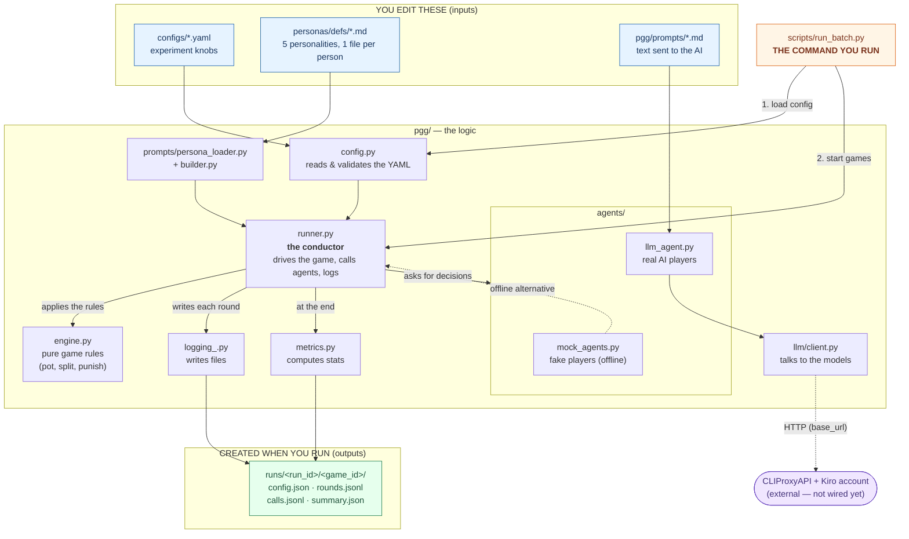

# Architecture — how the files connect

There is no single "mother file." The thing you **run** is
`scripts/run_batch.py`; the thing that **ties the logic together** is
`pgg/runner.py` (the conductor). Everything else is either an input you edit, a
library the conductor calls, or an output it produces.

## Diagram

## How to read it

1. You run `scripts/run_batch.py` — the only command.
2. It loads your chosen `configs/*.yaml` via `config.py`.
3. It hands control to `runner.py`, the conductor.
4. The conductor loops through each round: it asks `engine.py` to apply the
   rules, asks the agents (mock or LLM) for decisions, and — for LLM agents —
   sends prompts through `llm/client.py` to the models (CLIProxyAPI plugs in
   here).
5. Each round is written by `logging_.py`; at the end `metrics.py` computes the
   stats.
6. You get a `runs/<run_id>/<game_id>/` folder of data.

The three blue boxes are the only things you normally edit. The purple box
(CLIProxyAPI) is the one piece not yet connected.
